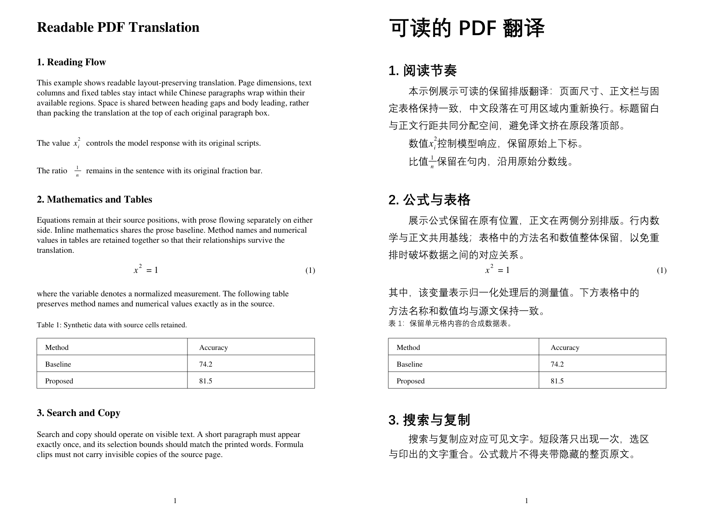
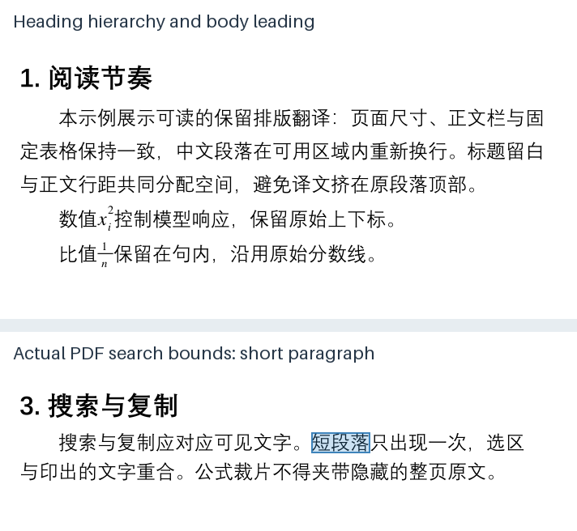
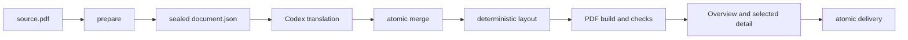

# Translate Layout PDF

English | [简体中文](README.md)

A layout-preserving PDF translation skill for Codex. The active Codex model performs semantic translation while a deterministic local engine preserves page size, columns, images, source formulas, tables, links, headers and footers.

It targets academic and technical PDFs with a usable text layer. Scanned documents require OCR first.



The English source is on the left; the current engine's Chinese output is on the right. The example shows body leading, heading hierarchy, inline scripts and fractions, a display equation, and unchanged table cells. The [generator](docs/generate_samples.py) creates original sample content with fixed example translations; no third-party paper is included.

## Highlights

- **Readable CJK typography:** composes same-page, same-column continuations before wrapping and gives short headings their body column's width. New body paragraphs use a two-em indent; available space is shared through bounded `1.50–1.80em` baseline spacing and level-specific heading gaps.
- **Source mathematics:** preserves inline glyphs as vectors with baseline metrics, including scripts, accents and fraction bars. Display equations remain fixed; prose on either side is laid out separately to keep punctuation and citations in place.
- **Selection, search and copy:** physically removes hidden source-page text from formula crops, including legacy-job rebuilds. Generated-font Unicode maps use NFC and UTF-16BE to avoid literal CJK search failures caused by Noto compatibility aliases.
- **Document-wide checks:** validates source/font/asset identity and tokens; checks bounds, overlap, missing glyphs, formula strokes, preserved regions, glyph counts and bilingual side isolation. Delivery binds the current build and review evidence to their hashes.
- **Less repeated review:** compact CLI diagnostics and page-specific `inspect --pages`. Review covers all-page overviews and risk-selected detail, with changed-page reports after repairs; `review --full` enables exhaustive high-resolution inspection.
- **Two outputs:** produces `translated.pdf` and side-by-side `bilingual.pdf`. Prose can redistribute space between fixed objects; use `build --layout-mode source` only for an explicit preference for vertical correspondence.

## Search and selection example



The blue box comes from the actual PDF search coordinates for “短段落” (short paragraph). The generator requires exactly one hit, verifies that copying its bounds returns the expected text, and runs text-layer integrity checks. This illustrates search coordinates; it is not a reader UI screenshot or a claim that every drag-selection gesture has been tested in every reader.

## Pipeline



Codex supplies translated text. `scripts/layout_pdf.py` performs extraction, contracts, typesetting, verification, and delivery without calling an external translation service.

## Installation

Python 3.10 or later is required.

```bash
git clone https://github.com/xiaoye-learner/translate-layout-pdf.git
cd translate-layout-pdf
python -m pip install -r requirements.txt
python scripts/layout_pdf.py doctor
```

Place the repository at `%CODEX_HOME%\skills\translate-layout-pdf` on Windows or `$CODEX_HOME/skills/translate-layout-pdf` on macOS/Linux. If `CODEX_HOME` is unset, use the `.codex/skills/translate-layout-pdf` directory under your user profile.

## Use in Codex

Attach a PDF and ask:

```text
Use $translate-layout-pdf to translate this PDF into Chinese, preserve its layout, and produce translated and bilingual versions.
```

See [SKILL.md](SKILL.md) for the complete operational contract.

## Development

```bash
python scripts/layout_pdf.py doctor
python -m unittest discover -s tests -v
python tests/run_sample.py ./sample-output
python docs/generate_samples.py ./sample-output/readme --assets-dir docs/assets
```

The `docs/generate_samples.py` command regenerates the README images. Use a fresh work directory. The generator checks the build, formulas and search hits; fonts are selected from the system or supplied with `--font` / `--bold-font`, so screenshots may vary slightly. `tests/run_sample.py` continues to generate the regression fixture.

Tests generate their own synthetic PDFs and do not require third-party papers. The current 54-test suite includes mixed formula/prose lines, overlapping formula fragments, tiny edge-contact tolerance, vector corner masks, column balancing around fixed objects, unchanged source flows, semantic boundaries at display equations, target-language collection-face selection, inline scripts and fractions, display equations, CJK indentation and leading, heading consistency and before-spacing, dense-region spacing fallback, continuation flows, protected tables, review gates, artifact tamper detection, and literal search across CJK font aliases and supplementary Unicode characters.

## Limitations

- Scanned documents require OCR, which this skill does not perform automatically.
- Detected tables are currently preserved as a whole rather than translated cell by cell.
- Author blocks, irregular encodings, complex vector artwork, and borderless tables can require manual review.
- Text that cannot fit the source page produces a stopping diagnostic instead of silently becoming unreadable.
- Fonts are not distributed with the repository; users must choose fonts whose embedding terms fit their outputs.
- Bilingual composition copies links but does not guarantee preservation of non-link annotations.
- Linear copy order for complex formula scripts remains reader-dependent; outputs do not claim full PDF/UA semantic tagging.
- The workflow aims to reduce repeated repairs. No cross-paper speed or token-saving benchmark is claimed, and first-build success is not guaranteed for every PDF.

## License

This project is licensed under [GNU Affero General Public License v3.0 only](LICENSE). The native engine imports the AGPL build of PyMuPDF in-process. Distribution and network use of modified versions must therefore follow the applicable AGPL corresponding-source requirements. See [THIRD_PARTY_NOTICES.md](THIRD_PARTY_NOTICES.md) for dependencies, design references, fonts, and release obligations. A Chinese engineering audit is available at [docs/LICENSE_AUDIT.zh-CN.md](docs/LICENSE_AUDIT.zh-CN.md).

See [CONTRIBUTING.md](CONTRIBUTING.md) before submitting changes or sample documents.
