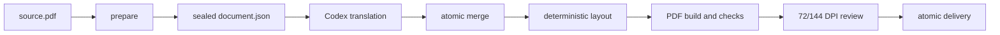

# Translate Layout PDF

English | [简体中文](README.md)

A layout-preserving PDF translation skill for Codex. The active Codex model performs semantic translation while a deterministic local engine preserves page size, columns, images, source formulas, tables, links, headers, footers, and annotations.

It targets academic and technical PDFs with a usable text layer. Scanned documents require OCR first.


The image is generated entirely by `tests/make_fixture.py` and contains no third-party paper content.

## Highlights

- Keeps inline mathematics as source-derived vector assets with baseline metrics.
- Flows inline formulas with prose while retaining display equations as standalone objects.
- Separates mathematics from prose on mixed lines, absorbs overlapping script/number fragments into the formula asset, and rejoins prose split across formulas into one semantic paragraph. This prevents formula-dense sentences from being skipped or leaving isolated blank areas.
- Uses relative overlap fractions for formula/prose collision decisions, tolerating tiny glyph-edge contact while retaining genuinely ambiguous source regions for review.
- Uses vector clipping when a neighboring line enters an empty corner of a formula crop, without removing any intended formula ink.
- Packs translated paragraphs within clear source column regions and distributes spare height through bounded leading and paragraph spacing. `build --layout-mode source` retains the earlier source-oriented vertical positioning.
- Reserves level-specific space before headings and gives heading expansion priority over extra body leading, keeping consecutive heading levels together and respecting dense-region limits.
- Keeps explicitly unchanged paragraph flows in the source PDF, including their original typography and links.
- Applies a two-em first-line indent to new Chinese and Japanese body paragraphs, excluding continuations.
- Uses consistent style-wide scaling and real bold fonts; CJK body expansion is capped at `1.20×`, while title and heading expansion is capped at `1.50×`.
- Selects the target-language face inside Linux TTC/OTC collections, so Simplified Chinese does not silently use Japanese glyph variants.
- Adds a small explicit leading increase for CJK body text; constrained short or formula frames use audited local fallback, and one-character final lines are rebalanced within the paragraph.
- Protects images, detected tables, standalone formulas, headers, footers, and other non-translatable regions.
- Validates schemas, hashes, source coverage, fonts, assets, token order, geometry, and final PDF structure.
- Produces translated and bilingual PDFs with hash-bound 72/144 DPI review evidence.

## Pipeline



Codex supplies translated text. `scripts/layout_pdf.py` performs extraction, contracts, typesetting, verification, and delivery without calling an external translation service.

## Installation

Python 3.10 or later is required.

```bash
git clone <repository-url> translate-layout-pdf
cd translate-layout-pdf
python -m pip install -r requirements.txt
python scripts/layout_pdf.py doctor
```

Place the repository at `%CODEX_HOME%\skills\translate-layout-pdf` on Windows or `$CODEX_HOME/skills/translate-layout-pdf` on macOS/Linux. If `CODEX_HOME` is unset, use the `.codex/skills/translate-layout-pdf` directory under your user profile.

## Use in Codex

Attach a PDF and ask:

```text
Use $translate-layout-pdf to translate this PDF into Chinese, preserve its layout, and produce translated and bilingual versions.
```

See [SKILL.md](SKILL.md) for the complete operational contract.

## Development

```bash
python scripts/layout_pdf.py doctor
python -m unittest discover -s tests -v
python tests/run_sample.py ./sample-output
```

Tests generate their own synthetic PDFs and do not require third-party papers. The current 40-test suite includes mixed formula/prose lines, overlapping formula fragments, tiny edge-contact tolerance, vector corner masks, column balancing around fixed objects, unchanged source flows, semantic boundaries at display equations, target-language collection-face selection, inline scripts and fractions, display equations, CJK indentation and leading, heading consistency and before-spacing, dense-region spacing fallback, continuation flows, protected tables, review gates, and artifact tamper detection.

## Limitations

- Scanned documents require OCR.
- Detected tables are currently preserved as a whole rather than translated cell by cell.
- Author blocks, irregular encodings, complex vector artwork, and borderless tables can require manual review.
- Text that cannot fit the source page produces a stopping diagnostic instead of silently becoming unreadable.
- Fonts are not distributed with the repository; users must choose fonts whose embedding terms fit their outputs.

## License

This project is licensed under [GNU Affero General Public License v3.0 only](LICENSE). The native engine imports the AGPL build of PyMuPDF in-process. Distribution and network use of modified versions must therefore follow the applicable AGPL corresponding-source requirements. See [THIRD_PARTY_NOTICES.md](THIRD_PARTY_NOTICES.md) for dependencies, design references, fonts, and release obligations. A Chinese engineering audit is available at [docs/LICENSE_AUDIT.zh-CN.md](docs/LICENSE_AUDIT.zh-CN.md).

See [CONTRIBUTING.md](CONTRIBUTING.md) before submitting changes or sample documents.
