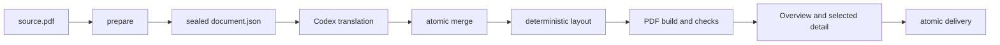

# Translate Layout PDF

[English](README.en.md) | 简体中文

一个面向 Codex 的 PDF 保留排版翻译 Skill。它使用当前 Codex 模型完成语义翻译，并用确定性的本地引擎保存页面尺寸、分栏、图片、源公式、表格、链接、页眉页脚。

适合带文字层的学术论文与技术文档。扫描 PDF 需要先经过 OCR。


左侧为英文源页，右侧为当前引擎的中文输出。样例展示正文行距、标题层级、行内上下标、分式、独立公式与原样保留的表格。内容由仓库中的 [生成脚本](docs/generate_samples.py) 原创，使用固定的示例译文，不包含第三方论文。

## 特性

- **可读的中文排版**：同页同栏的连续段落先合并再换行，短标题继承正文栏宽。新正文段落使用 `2em` 首行缩进；有空间时，正文基线间距按 `1.50–1.80em` 分配，标题前后留白按层级调整。
- **保留数学结构**：行内公式使用带基线信息的源矢量字形，保留上下标、重音和分数线；展示公式保持原有位置。公式两侧的正文分别排版，避免把句末标点或引用移到公式另一侧。
- **可选中、可搜索、可复制**：公式裁片实际移除多余的隐藏文字，旧任务重建时也会清理。生成字体的 Unicode 映射使用 NFC 与 UTF-16BE，避免 Noto CJK 兼容字造成中文搜索失败。
- **全篇程序检查**：验证源文件、字体、资产和 token，检查页面边界、重叠、缺失字形、公式笔画、保留区域、文字数量与双语左右边界。最终交付绑定当前构建与审阅证据的哈希。
- **减少重复复核**：CLI 默认只汇总诊断；`inspect --pages` 展开指定页。默认查看全篇总览和风险页，修复后报告变化页；需要逐页高清检查时使用 `review --full`。
- **两种输出**：生成中文单语版 `translated.pdf` 与左右对照版 `bilingual.pdf`。正文可在固定对象之间重新分配空间；仅在明确需要纵向对应时使用 `build --layout-mode source`。

## 搜索与选区示例


## 工作流程



翻译内容由 Codex 生成；`scripts/layout_pdf.py` 只负责解析、契约、排版、验证和交付，不调用外部翻译服务。

## 安装

要求 Python 3.10 及以上版本。

```bash
git clone https://github.com/xiaoye-learner/translate-layout-pdf.git
cd translate-layout-pdf
python -m pip install -r requirements.txt
python scripts/layout_pdf.py doctor
```

将仓库目录放到 Codex 的个人 Skill 目录：

- Windows：`%CODEX_HOME%\skills\translate-layout-pdf`
- macOS/Linux：`$CODEX_HOME/skills/translate-layout-pdf`

如果没有设置 `CODEX_HOME`，通常可使用用户目录下的 `.codex/skills/translate-layout-pdf`。

## 在 Codex 中使用

附加一个 PDF，然后输入：

```text
使用 $translate-layout-pdf 将这个 PDF 翻译为中文，保留原始排版，并同时生成目标版和双语版。
```

Skill 会创建独立的任务目录，依次执行准备、针对性解析检查、语义翻译、结构验证、构建、视觉检查和原子交付。源语言重建按解析风险选用；详细操作契约见 [SKILL.md](SKILL.md)。

## 开发与测试

```bash
python scripts/layout_pdf.py doctor
python -m unittest discover -s tests -v
python tests/run_sample.py ./sample-output
python docs/generate_samples.py ./sample-output/readme --assets-dir docs/assets
```

README 图片由 `docs/generate_samples.py` 命令重新生成，运行时请使用新的工作目录。生成脚本会校验构建、公式和搜索命中；字体随系统环境选择，可用 `--font` 与 `--bold-font` 指定，截图细节可能随字体略有差异。原来的 `tests/run_sample.py` 继续用于生成回归测试样例。

自动测试生成自己的合成 PDF，不需要下载或提交第三方论文。当前 54 项测试覆盖行内上下标、行内分式、独立公式、公式与正文混排行、重叠公式碎片吸收、微小边缘接触、公式空角矢量蒙版、栏区均衡与固定对象边界、原文保留及独立公式前后语义边界、目标语言字体集合选择、二字缩进、中文行距、段末孤字重排、标题一致性与段前间距、密集栏区间距回退、跨栏续段、链接、表格保护、原子批次、审查门禁、产物篡改检测、CJK 字体别名和补充平面字符的原文搜索。

## 仓库结构

```text
translate-layout-pdf/
├── SKILL.md
├── agents/
├── references/
├── schemas/
├── scripts/
│   ├── layout_pdf.py
│   └── layoutpdf/
├── tests/
├── requirements.txt
├── THIRD_PARTY_NOTICES.md
└── LICENSE
```

## 当前边界

- 扫描件需要先做 OCR，本 skill 不自动完成 OCR。
- 检测到的表格当前整体保留，不翻译单元格。
- 作者机构区、复杂矢量插图内部文字、异常字体编码和无边框表格可能需要人工检查。
- 译文超过原始页面容量时，引擎会停止并报告诊断，不会静默缩成不可读的小字。
- 字体文件不随仓库分发；使用者需要提供允许相应嵌入和再分发方式的字体。
- 双语拼接会复制链接，但不保证完整保留非链接批注。
- 复杂公式复制成单行文本时，上下标顺序仍可能受阅读器影响；输出不宣称符合完整的 PDF/UA 语义标记规范。
- 布局改进用于减少反复修复，但没有跨论文的速度或 token 节省基准，不保证所有 PDF 首次构建都通过。

## 许可证

本项目采用 [GNU Affero General Public License v3.0 only](LICENSE)。当前引擎在进程内直接使用 AGPL 版 PyMuPDF，因此分发或通过网络提供修改版时，需要遵守 AGPL 的对应源码义务。需要闭源或其他许可方式时，应取得 Artifex 商业许可或替换 PyMuPDF/MuPDF。

直接依赖、设计参考、字体和发布注意事项见 [THIRD_PARTY_NOTICES.md](THIRD_PARTY_NOTICES.md)，中文审计记录见 [docs/LICENSE_AUDIT.zh-CN.md](docs/LICENSE_AUDIT.zh-CN.md)。

## 设计参考

架构设计研究过 Archify、BabelDOC、PDFMathTranslate 和 PDFMathTranslate-next。当前仓库不包含这些项目的源码、schema、测试、资产或运行后端；具体提交和参考范围记录在第三方声明中。

欢迎提交最小、可复现且不含受版权保护论文或敏感文档的问题样例。贡献要求见 [CONTRIBUTING.md](CONTRIBUTING.md)。
