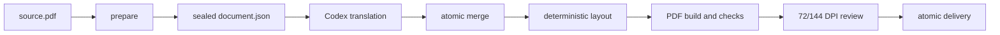

# Translate Layout PDF

[English](README.en.md) | 简体中文

一个面向 Codex 的 PDF 保留排版翻译 Skill。它使用当前 Codex 模型完成语义翻译，并用确定性的本地引擎保存页面尺寸、分栏、图片、源公式、表格、链接、页眉页脚和批注。

适合带文字层的学术论文与技术文档。扫描 PDF 需要先经过 OCR。


上图完全由 `tests/make_fixture.py` 生成，不包含第三方论文内容。

## 特性

- 将行内公式保存为带基线信息的源生矢量资产，避免上下标、根式和分数被扁平化。
- 行内公式随正文共同换行；独立公式维持展示公式布局。
- 将同一行内的公式片段和自然语言分开识别，吸收重叠的上下标/数字碎片，并把跨公式切开的正文重新合并为一个语义段落，避免公式密集句漏译或产生孤立空白。
- 采用相对重叠比例而非固定面积判断公式与正文碰撞，容忍字体边缘的微小接触，同时保留真正有歧义的源区域供复核。
- 中文和日文新正文段落使用 `2em` 首行缩进，跨栏、跨页续段不重复缩进。
- 同级标题统一字号和真实粗体字体；中文正文最多扩张到 `1.20×`，标题最多扩张到 `1.50×`。
- 在 Linux 的 TTC/OTC 字体集合中按目标语言选择字体面，简体中文不会误用日文字形变体。
- 中文正文额外增加少量行距；受限的短段或公式框可审计地局部回退，段末单汉字通过段内换行重排解决。
- 保留图片、检测到的表格、独立公式、页眉页脚和其他受保护区域。
- 构建前验证 schema、源文件、字体、资产、公式 token、覆盖率及结构哈希。
- 生成目标版和双语版 PDF，并在交付前绑定 72/144 DPI 视觉证据与文件哈希。

## 工作流程



翻译内容由 Codex 生成；`scripts/layout_pdf.py` 只负责解析、契约、排版、验证和交付，不调用外部翻译服务。

## 安装

要求 Python 3.10 及以上版本。

```bash
git clone <repository-url> translate-layout-pdf
cd translate-layout-pdf
python -m pip install -r requirements.txt
python scripts/layout_pdf.py doctor
```

将仓库目录放到 Codex 的个人 Skill 目录：

- Windows：`%CODEX_HOME%\skills\translate-layout-pdf`
- macOS/Linux：`$CODEX_HOME/skills/translate-layout-pdf`

如果没有设置 `CODEX_HOME`，通常可使用用户目录下的 `.codex/skills/translate-layout-pdf`。

## 在 Codex 中使用

附加一个 PDF，然后输入：

```text
使用 $translate-layout-pdf 将这个 PDF 翻译为中文，保留原始排版，并同时生成目标版和双语版。
```

Skill 会创建独立的任务目录，依次执行准备、源语言预检、语义翻译、结构验证、构建、视觉检查和原子交付。详细操作契约见 [SKILL.md](SKILL.md)。

## 开发与测试

```bash
python scripts/layout_pdf.py doctor
python -m unittest discover -s tests -v
python tests/run_sample.py ./sample-output
```

自动测试生成自己的合成 PDF，不需要下载或提交第三方论文。当前 34 项测试覆盖行内上下标、行内分式、独立公式、公式与正文混排行、重叠公式碎片吸收、微小边缘接触、目标语言字体集合选择、二字缩进、中文行距、段末孤字重排、标题一致性、跨栏续段、链接、表格保护、原子批次、审查门禁和产物篡改检测。

## 仓库结构

```text
translate-layout-pdf/
├── SKILL.md
├── agents/
├── references/
├── schemas/
├── scripts/
│   ├── layout_pdf.py
│   └── layoutpdf/
├── tests/
├── requirements.txt
├── THIRD_PARTY_NOTICES.md
└── LICENSE
```

## 当前边界

- 扫描件需要先做 OCR。
- 检测到的表格当前整体保留，不翻译单元格。
- 作者机构区、复杂矢量插图内部文字、异常字体编码和无边框表格可能需要人工检查。
- 译文超过原始页面容量时，引擎会停止并报告诊断，不会静默缩成不可读的小字。
- 字体文件不随仓库分发；使用者需要提供允许相应嵌入和再分发方式的字体。

## 许可证

本项目采用 [GNU Affero General Public License v3.0 only](LICENSE)。当前引擎在进程内直接使用 AGPL 版 PyMuPDF，因此分发或通过网络提供修改版时，需要遵守 AGPL 的对应源码义务。需要闭源或其他许可方式时，应取得 Artifex 商业许可或替换 PyMuPDF/MuPDF。

直接依赖、设计参考、字体和发布注意事项见 [THIRD_PARTY_NOTICES.md](THIRD_PARTY_NOTICES.md)，中文审计记录见 [docs/LICENSE_AUDIT.zh-CN.md](docs/LICENSE_AUDIT.zh-CN.md)。

## 设计参考

架构设计研究过 Archify、BabelDOC、PDFMathTranslate 和 PDFMathTranslate-next。当前仓库不包含这些项目的源码、schema、测试、资产或运行后端；具体提交和参考范围记录在第三方声明中。

欢迎提交最小、可复现且不含受版权保护论文或敏感文档的问题样例。贡献要求见 [CONTRIBUTING.md](CONTRIBUTING.md)。
